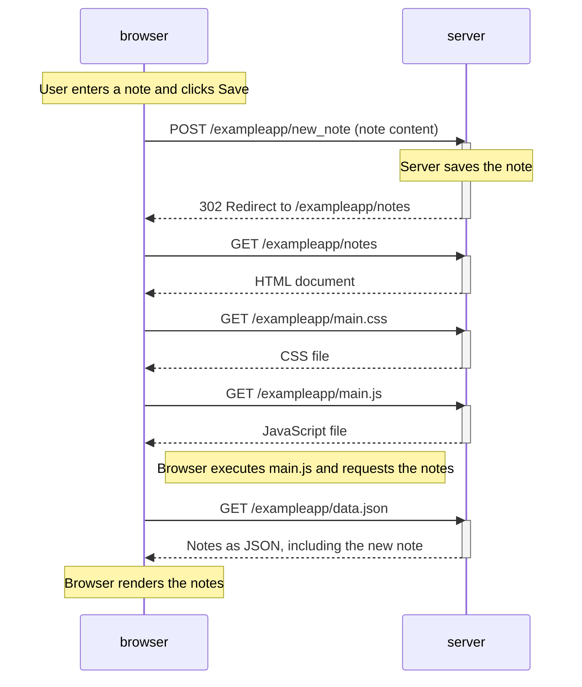
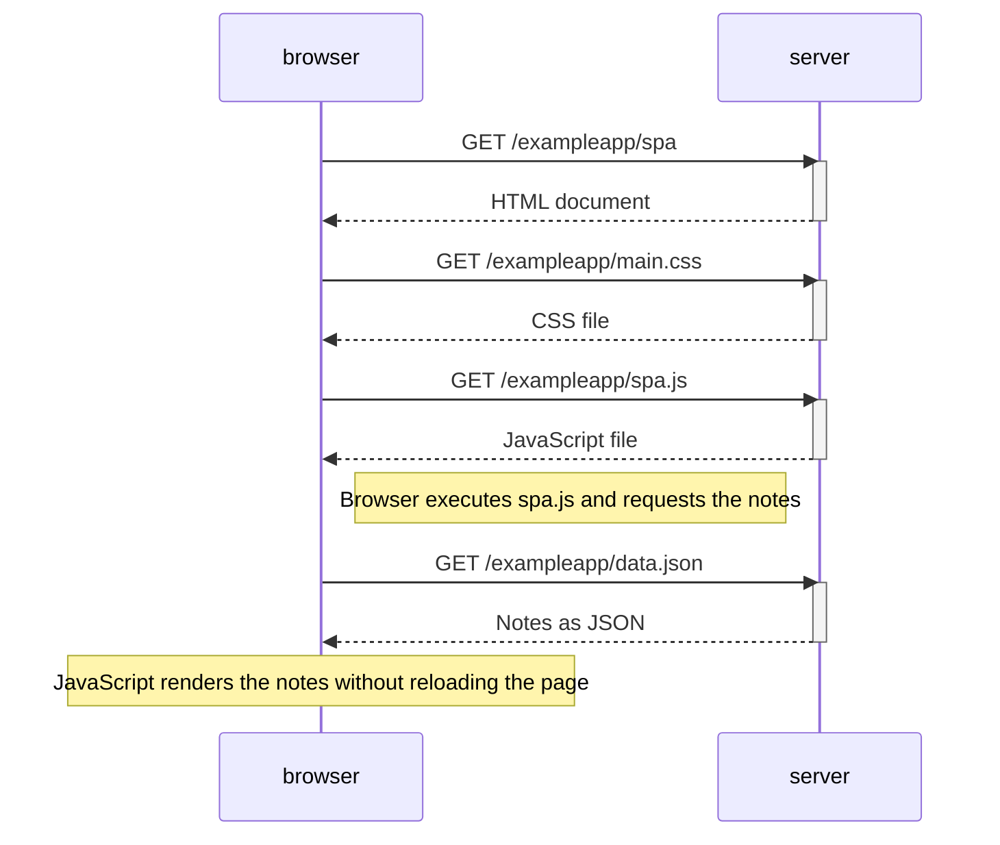

# Part 0

## 0.4: New note



## 0.5: Single page app



## 0.6: New note in the single page app

```mermaid
sequenceDiagram
    participant browser
    participant server

    Note over browser: User enters a note and clicks Save
    Note right of browser: JavaScript prevents the default form submission
    Note right of browser: JavaScript creates the note and renders it on the page

    browser->>server: POST /exampleapp/new_note_spa (note as JSON)
    activate server
    Note over server: Server saves the note
    server-->>browser: 201 Created
    deactivate server

    Note over browser: Page remains loaded; no redirect or new GET request
```
